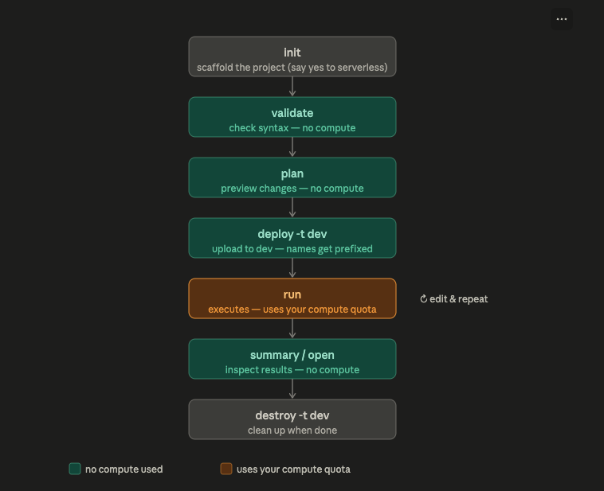
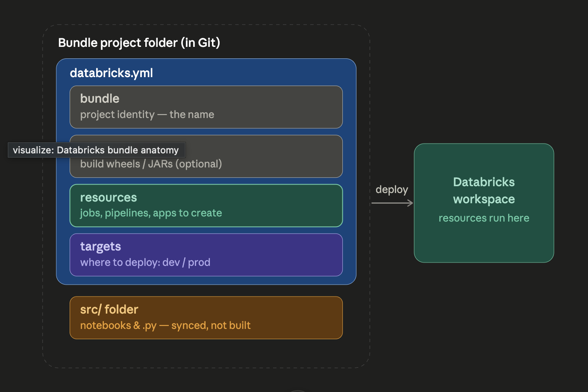
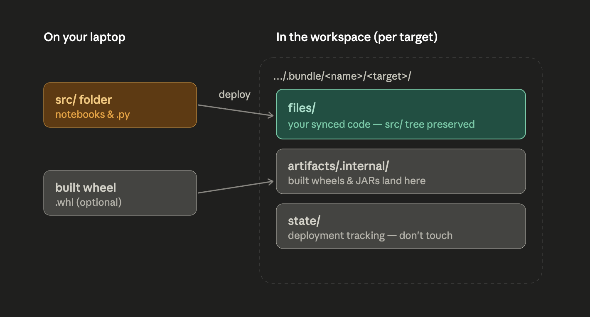

# Bundles Guide

Learning guide and reference for Declarative Automation Bundles on Free
Edition: the CLI, `databricks.yml` (`databricks.yaml` also works; this repo uses
it), hands-on tutorials, and how to reference source files from jobs and pipelines.
It's generic; how *this* repo deploys is in
[MULTI_ENVIRONMENT_DEPLOYMENTS.md](MULTI_ENVIRONMENT_DEPLOYMENTS.md).

> **Notebooks and `.py` files are not "artifacts."** Artifacts are *built* things
> only (wheels, JARs). Source code lives in `src/` and is *synced*, not built.

---

## 0. Read this first: can a mistake cost me money?

**No — not on Free Edition.** Databricks Free Edition is **free forever**. There is
no credit card and no bill.

What a mistake *can* cost you is your **daily compute quota**. Free Edition runs on serverless
compute under a fair-usage policy: if you burn through the quota, your compute is paused for the
rest of the day (rarely, the rest of the month). Your data and settings are never deleted — you
just wait for the reset.

So "expensive mistake" here means **wasting quota on a bad run**, or worse, **learning a habit
that would cost real money on a paid workspace later**. Everything in this tutorial is built
around a workflow that stays safe in both worlds:



Only `run` spends compute. `validate`, `plan`, `deploy`, `summary`, and `destroy` do not.
Get in the habit of validating and planning *every* time before you deploy, and always working
in a `dev` target first. That habit is your entire cost-safety strategy.

---

## 1. The mental model: four blocks, each answers ONE question

A bundle is a project folder described as code. It has four YAML blocks plus your source files.
Here is the whole thing at a glance:



| Block (YAML key) | The one question it answers | What goes in it |
|---|---|---|
| `bundle:` | *What is this project called?* | Just the name (part of the bundle's identity). |
| `artifacts:` | *What needs to be **built**?* | Python wheels, JARs. **Optional** — skip it if you have no custom package. |
| `resources:` | *What Databricks **objects** am I deploying?* | jobs, pipelines, apps, dashboards, models, schemas, volumes… |
| `targets:` | *****Where** and in what **mode**?* | dev/prod workspaces + per-environment overrides. |
| `src/` (not a block) | *What **code** runs?* | notebooks and `.py` files — just sit in the folder, referenced by resources. |

**How they connect:** artifacts get *built* and source files get *synced*; `resources` point at
both (a task references `notebook_path: ../src/x.py` or a built `whl`); `targets` decide which
workspace it all lands in and with what overrides.

Where things land after `deploy`:



---

## 2. Free Edition constraints (memorize these)

| Constraint | What it means for your bundle |
|---|---|
| **Serverless only** | No classic clusters. Never write `new_cluster` / `job_clusters` with node types — they will fail. |
| **Say "yes" to serverless** | The `default-python` template asks; answer yes. For pipelines, set `serverless: true`. |
| **Deploy from your laptop** | Deploying *inside* the serverless workspace can fail (the old Terraform engine tries to reach `releases.hashicorp.com`, which is blocked). Deploy from your **local CLI**. |
| **Direct engine avoids Terraform** | Newer CLI versions offer a Terraform-free engine. Run `databricks bundle deployment migrate` to switch a bundle to it. |
| **Wheels install differently** | On serverless, prefer `%pip install` in the notebook or an `environments` spec over classic cluster libraries. |
| **Limited outbound internet** | Only a small set of trusted domains is reachable from compute. |

---

## 3. Install and authenticate the CLI

```bash
# Install (pick your platform)
brew install databricks                                   # macOS / Linux (Homebrew)
winget install Databricks.DatabricksCLI                   # Windows
curl -fsSL https://raw.githubusercontent.com/databricks/setup-cli/main/install.sh | sh

# Verify — you want v0.218.0 or higher (v1.x is current in 2026)
databricks --version
```

Authenticate to your Free Edition workspace with OAuth (browser login; no token to
copy or rotate):

```bash
databricks auth login --host https://<your-workspace>.cloud.databricks.com --profile <name>
#   host: copy from the browser, no trailing slash
databricks current-user me --profile <name>      # test it
```

Personal access tokens (`databricks configure`) still work, but OAuth is the
recommended method for interactive use.

---

## 4. Full command reference (with examples)

Every command is `databricks bundle <command>`. Add `-h` to any command to see its flags.

### `init` — start a new bundle from a template

```bash
databricks bundle init                    # interactive template picker
databricks bundle init default-python     # standard Python template by name
databricks bundle init https://github.com/org/template   # custom template from Git
```

The Python template asks **"Use serverless?"** → answer **yes** on Free Edition.

### `validate` — check the config is correct *(no compute)*

```bash
databricks bundle validate            # default target
databricks bundle validate -t prod    # a specific target
```

Prints the bundle identity and `Validation OK!`, and warns about unknown properties. Run it constantly.

### `plan` — preview what a deploy will do *(no compute)*

```bash
databricks bundle plan
# create jobs.my_bundle_job
# create pipelines.my_bundle_pipeline
```

The "terraform plan" of bundles: shows create/update/delete actions **without changing anything**.
Use `--select my_job` to scope it to one resource.

### `deploy` — push artifacts + resources to the workspace *(no compute run)*

```bash
databricks bundle deploy -t dev
databricks bundle deploy -t prod
```

Re-deploy behavior: in-config-but-not-in-workspace → **created**; in both → **updated**;
removed-from-config → **deleted**. Useful flags:

- `--auto-approve` — skip prompts (CI).
- `--fail-on-active-runs` — abort if something is currently running.
- `--force-lock` — reclaim a stale lock after a crash.
- `--select my_job` — **dev only**, deploy one resource + upstreams (not for prod).

### `run` — run a job, pipeline, app, or script *(THIS uses compute)*

```bash
databricks bundle run hello_job                 # run a job
databricks bundle run -t dev hello_job          # in a target
databricks bundle run                           # no key → picker
```

Pass parameters (recommended way):

```bash
databricks bundle run --params run_date=2026-08-07,region=eu hello_job
```

Run only some tasks (dependency modifiers: `+` prefix = upstreams, suffix `+` = downstreams):

```bash
databricks bundle run --only ingest,transform hello_job
databricks bundle run --only +transform+ hello_job
```

Pipelines:

```bash
databricks bundle run my_pipeline --validate-only     # graph check, no materialization
databricks bundle run my_pipeline --full-refresh-all
```

Apps must be re-run after each deploy to pick up new code:

```bash
databricks bundle deploy -t prod && databricks bundle run my_app -t prod
```

Other flags: `--no-wait` (return immediately), `--restart` (cancel + rerun a live run).

### `summary` — deployed identity + clickable links *(no compute)*

```bash
databricks bundle summary
databricks bundle summary --force-pull   # ignore local cache, read state from workspace
```

### `open` — jump to a resource in the browser *(no compute)*

```bash
databricks bundle open                     # picker
databricks bundle open my_pipeline
```

### `generate` — reverse-engineer YAML from existing workspace resources

Supported: `job`, `pipeline`, `dashboard`, `app`, `genie-space`.

```bash
databricks bundle generate job --existing-job-id 123456789 --bind
databricks bundle generate pipeline --existing-pipeline-id abc-123-def
```

> **Without `--bind`, deploying the generated config creates a NEW resource instead of updating
> the existing one.** Always `--bind` (or run `bundle deployment bind`) when adopting something
> you built in the UI. Job generate currently supports notebook-task jobs only.

### `deployment` — bind / unbind / migrate

```bash
databricks bundle deployment bind hello_job 123456789 -t dev     # attach to existing job
databricks bundle deployment unbind hello_job
databricks bundle deployment migrate                             # move off Terraform (direct engine)
```

Bind ID formats: job = numeric ID, pipeline = UUID, Unity Catalog objects = full
`catalog.schema[.object]` name.

### `sync` — one-way file sync (local → workspace) *(no compute)*

```bash
databricks bundle sync --dry-run
databricks bundle sync --watch     # continuous sync while you edit
```

### `schema` — dump the JSON schema of `databricks.yml`

```bash
databricks bundle schema > bundle_config_schema.json   # point your IDE at this for autocomplete
```

### `destroy` — delete everything the bundle deployed *(no compute)*

```bash
databricks bundle destroy -t dev                 # prompts to confirm
databricks bundle destroy -t dev --auto-approve
```

⚠️ **Permanent.** Deletes the bundle's deployed jobs, pipelines, and artifacts. Protect specific
resources with a `lifecycle` setting if you don't want them destroyable.

### Global flags (any command)

| Flag | Purpose |
|---|---|
| `-t, --target <name>` | Which target to act on |
| `-p, --profile <name>` | Auth profile from `~/.databrickscfg` |
| `--var "foo=bar"` | Override a bundle variable at runtime |
| `-o, --output text\|json` | Output format |
| `--debug` | Verbose logging |
| `-h, --help` | Help for any command |

---

## 5. Anatomy of a real `databricks.yml` (fully annotated)

```yaml
# BLOCK 1 — identity
bundle:
  name: sales_project

# Pull in resource files kept in a resources/ folder (keeps databricks.yml small)
include:
  - resources/*.yml

# Reusable values, overridable per target
variables:
  catalog:
    description: Catalog to write to
    default: main

# BLOCK 2 — artifacts: ONLY things that must be built. Omit entirely if none.
# artifacts:
#   my_lib:
#     type: whl
#     build: python -m build --wheel
#     path: ./my_lib

# BLOCK 3 — resources: the Databricks objects to create
resources:
  jobs:
    daily_sales_job:
      name: daily_sales_job
      parameters:
        - name: run_date
          default: "2026-08-01"
      tasks:
        - task_key: ingest
          notebook_task:
            notebook_path: ../src/ingest.py     # references a SOURCE file (synced)
      # No cluster block => serverless (required on Free Edition)

# BLOCK 4 — targets: environments, each can override the blocks above
targets:
  dev:
    mode: development        # prefixes names "[dev you]", pauses schedules — SAFE sandbox
    default: true
    variables:
      catalog: main
    workspace:
      host: https://<your-workspace>.cloud.databricks.com
  prod:
    mode: production         # strict validation, no name prefixing
    variables:
      catalog: main
    workspace:
      host: https://<your-workspace>.cloud.databricks.com
```

`mode: development` vs `mode: production` is your built-in safety switch. Dev prefixes every
resource with `[dev your_name]`, pauses schedules and triggers, and tags runs as dev — so you can
iterate without ever touching a production object.

---

## 6. Tutorials (hands-on, Free Edition, run locally)

Each builds on the last. Run everything from your **local terminal**.

### Tutorial 1 — Your first bundle end to end

```bash
databricks bundle init default-python
#   Project name: my_first_bundle
#   Include a notebook? yes
#   Include a pipeline? no
#   Include a Python package? no
#   Use serverless? YES        <-- required

cd my_first_bundle

databricks bundle validate      # "Validation OK!"  (free)
databricks bundle plan          # preview: create jobs.<name>  (free)
databricks bundle deploy -t dev # upload to dev  (free)
databricks bundle summary       # grab the deep link
databricks bundle run -t dev <job_key>   # the ONE step that uses compute
databricks bundle destroy -t dev         # clean up  (free)
```

Your job shows up under **Jobs & Pipelines** as `[dev your_name] ...`, and files land under
`/Workspace/Users/you@x.com/.bundle/my_first_bundle/dev/files`.

### Tutorial 2 — A serverless job from scratch

`resources/etl_job.yml`:

```yaml
resources:
  jobs:
    etl_job:
      name: etl_job
      parameters:
        - name: run_date
          default: "2026-08-01"
      tasks:
        - task_key: ingest
          notebook_task:
            notebook_path: ../src/ingest.py
        - task_key: transform
          depends_on:
            - task_key: ingest
          notebook_task:
            notebook_path: ../src/transform.py
      # No cluster => serverless
```

`src/ingest.py`:

```python
# Databricks notebook source
dbutils.widgets.text("run_date", "")
run_date = dbutils.widgets.get("run_date")
print(f"Ingesting for {run_date}")
```

```bash
databricks bundle validate
databricks bundle deploy -t dev
databricks bundle run --params run_date=2026-08-07 etl_job -t dev
databricks bundle run --only transform etl_job -t dev   # run just one task
```

### Tutorial 3 — A serverless Lakeflow pipeline

`resources/sample_pipeline.yml`:

```yaml
resources:
  pipelines:
    sample_pipeline:
      name: sample_pipeline
      serverless: true          # required on Free Edition
      catalog: main
      schema: default
      libraries:
        - notebook:
            path: ../src/pipeline.py

  jobs:
    run_pipeline_job:
      name: run_pipeline_job
      tasks:
        - task_key: refresh
          pipeline_task:
            pipeline_id: ${resources.pipelines.sample_pipeline.id}   # substitution, resolved at deploy
```

`src/pipeline.py`:

```python
from pyspark import pipelines as dp   # replaces the legacy `import dlt`

@dp.materialized_view
def sample_table():
    return spark.range(10).withColumnRenamed("id", "n")
```

```bash
databricks bundle deploy -t dev
databricks bundle run sample_pipeline --validate-only -t dev   # graph check first (cheap)
databricks bundle run sample_pipeline -t dev                   # real run
```

### Tutorial 4 — Variables and multiple environments

```yaml
variables:
  catalog:
    default: main
  notifications_email:
    default: ""

resources:
  jobs:
    etl_job:
      name: etl_job-${var.catalog}
      email_notifications:
        on_failure:
          - ${var.notifications_email}
      tasks:
        - task_key: main
          notebook_task:
            notebook_path: ../src/main.py

targets:
  dev:
    mode: development
    default: true
    variables:
      catalog: sandbox
  prod:
    mode: production
    variables:
      catalog: main
      notifications_email: alerts@example.com
```

```bash
databricks bundle deploy -t dev
databricks bundle deploy -t prod
databricks bundle deploy -t dev --var "catalog=scratch"   # ad-hoc override
```

### Tutorial 5 — Adopt a job you built in the UI

```bash
# Job ID comes from the job page URL in the workspace
databricks bundle generate job --existing-job-id 123456789 --bind
```

This writes `resources/<job>.yml`, downloads the referenced notebooks into `src/`, and (because of
`--bind`) links the config to the real job so your next `deploy` **updates** it instead of cloning
it. Commit to Git — you're now managing it as code.

### Tutorial 6 (optional) — Build and use a Python wheel

Only needed when you have reusable Python code to share across tasks.

Project addition:

```
my_lib/
├── pyproject.toml
└── src/my_lib/__init__.py
```

`my_lib/pyproject.toml`:

```toml
[build-system]
requires = ["setuptools>=61.0", "wheel"]
build-backend = "setuptools.build_meta"

[project]
name = "my_lib"
version = "0.1.0"
```

In `databricks.yml`:

```yaml
artifacts:
  my_lib:
    type: whl
    build: python -m build --wheel   # runs locally during deploy
    path: ./my_lib

resources:
  jobs:
    wheel_job:
      name: wheel_job
      tasks:
        - task_key: main
          python_wheel_task:
            package_name: my_lib
            entry_point: main
          libraries:
            - whl: ./my_lib/dist/*.whl
```

On `deploy`, the CLI runs the build command, produces the `.whl`, uploads it, and installs it on
the task. On Free Edition serverless, if the classic library install is awkward, fall back to
`%pip install` inside a notebook instead.

---

## 7. Referencing source files from jobs and pipelines

The most common "why won't my `.py` run" bug: in a **job**, `libraries` is for
**dependencies to install**, not your source. Source goes in the **task-type field**.
And a `.py` can be *either* a notebook *or* a script, which decides the field.
(Source: the bundle `job-task-types` and `library-dependencies` docs.)

### 7.1 The mental model

```
JOB TASK
 ├─ <task_type>: …        ← your SOURCE goes here (notebook_path / python_file / …)
 └─ libraries: […]        ← DEPENDENCIES to install (whl / jar / pypi / …). NOT source.

PIPELINE (Lakeflow Declarative Pipelines)
 └─ libraries: […]        ← your SOURCE goes here (notebook: / file: / glob:)
```

Same word, `libraries`, opposite meaning in the two resources.


### 7.2 The `.py` fork (most common mistake)

A `.py` file can be two different things:

| The file is… | How it looks | Reference it with |
|---|---|---|
| A **Databricks notebook** in source format | First line `# Databricks notebook source`; cells split by `# COMMAND ----------` | `notebook_task.notebook_path` |
| A **plain Python script** | Ordinary `.py`, no notebook header | `spark_python_task.python_file` |

Pointing the wrong field at the file fails. Match the field to what the file *is*.


### 7.3 Correct field per file type — JOB tasks

| What you have | Task type key | Path/reference field | Notes |
|---|---|---|---|
| Notebook (`.ipynb`, or `.py`/`.sql`/`.r`/`.scala` in notebook source format) | `notebook_task` | `notebook_path` | Path required; absolute in workspace, relative in repo |
| Plain Python script (`.py`) | `spark_python_task` | `python_file` | Does **not** support dynamic value references |
| Packaged Python wheel | `python_wheel_task` | `package_name` + `entry_point` | The wheel goes in `libraries: - whl:` |
| JAR (Java/Scala) | `spark_jar_task` | `main_class_name` | The jar goes in `libraries: - jar:` |
| SQL file (`.sql`) | `sql_task` | `file: { path: … }` | Also `query:`/`alert:`/`dashboard:` variants |
| dbt project | `dbt_task` | `project_directory` + `commands` | dbt adapter via `libraries: - pypi:` |
| A pipeline | `pipeline_task` | `pipeline_id` | Use `${resources.pipelines.<name>.id}` |
| Another job | `run_job_task` | `job_id` | Use `${resources.jobs.<name>.id}` |
| Dashboard refresh | `dashboard_task` | `dashboard_id` | |

#### Examples
```yaml
resources:
  jobs:
    my_job:
      tasks:

        # Notebook (.py in notebook source format, or .ipynb)
        - task_key: nb
          notebook_task:
            notebook_path: ../src/my_notebook.py     # .ipynb also fine
            # source: WORKSPACE                       # default; leave as-is
            base_parameters:
              env: ${bundle.target}

        # Plain Python script
        - task_key: script
          spark_python_task:
            python_file: ../src/my_script.py
            parameters: ["--date", "{{job.start_time.iso_date}}"]

        # Python wheel (packaged code)
        - task_key: wheel
          python_wheel_task:
            package_name: my_package
            entry_point: run
          libraries:
            - whl: ../dist/my_package-*.whl

        # JAR
        - task_key: jar
          spark_jar_task:
            main_class_name: com.example.Main
          libraries:
            - jar: /Volumes/main/default/vol/app-0.1.0.jar

        # SQL file
        - task_key: sql
          sql_task:
            warehouse_id: 1a111111a1111aa1
            file:
              path: ../src/query.sql
              source: WORKSPACE
```


### 7.4 What `libraries` accepts (JOB task) — dependencies only

`libraries` installs packages on the cluster. Valid entry keys:

| Key | For | Example |
|---|---|---|
| `whl` | Python wheel file | `- whl: ../dist/pkg-*.whl` |
| `jar` | Java/Scala JAR | `- jar: /Volumes/…/app.jar` |
| `pypi` | PyPI package | `- pypi: { package: "requests==2.31.0" }` |
| `maven` | Maven coordinates | `- maven: { coordinates: "com.foo:bar:1.0" }` |
| `cran` | R package | `- cran: { package: "forecast" }` |
| `egg` | Python egg (legacy) | `- egg: ../dist/pkg.egg` |
| `requirements` | requirements.txt | `- requirements: /Workspace/${workspace.file_path}/requirements.txt` |

❌ There is **no** `notebook:`, `file:`, or `python_file:` key under a job task's `libraries`.
Your `.py`/`.ipynb` source never goes here.


### 7.5 PIPELINE libraries — source DOES go here

In a `pipelines` resource, `libraries` is where you list source:

```yaml
resources:
  pipelines:
    my_pipeline:
      name: my_pipeline
      catalog: main
      schema: analytics
      libraries:
        - notebook:
            path: ../src/bronze.py      # notebook-format .py
        - notebook:
            path: ../src/silver.ipynb
        - file:
            path: ../src/helpers.py     # plain .py imported as a module
        - glob:
            include: ../src/transforms/**
```

| Key | For |
|---|---|
| `notebook: { path: … }` | A notebook (source-format `.py` or `.ipynb`) |
| `file: { path: … }` | A plain source file |
| `glob: { include: … }` | Multiple files by pattern |


### 7.6 Path & `source` rules (both jobs and pipelines)

- **Relative paths** are relative to the **YAML file that declares the task**, e.g. `../src/foo.py`.
  Files are synced to the workspace on `bundle deploy`.
- **Absolute** workspace paths begin with `/Workspace/…` (or `/Users/…`).
- The `source` field (`notebook_task`, `spark_python_task`, `sql_task.file`) can be `WORKSPACE`
  (default) or `GIT`. **Prefer `WORKSPACE` for bundles.** `source: GIT` (and job `git_source`) is
  *not recommended* for bundles because local relative paths may not match repo content — instead,
  put your bundle project inside the cloned repo so sources resolve from the workspace.
- `spark_python_task.python_file` does **not** support dynamic value references — keep it a literal
  path (bundle `${...}` substitutions still resolve at deploy, but avoid `{{...}}` here).


### 7.7 Quick troubleshooting

| Symptom | Likely cause | Fix |
|---|---|---|
| `.py` "not found" / not treated as code | Put source under `libraries:` in a **job** | Move it to `notebook_task.notebook_path` or `spark_python_task.python_file` |
| Notebook magics / `dbutils` fail in a script task | Notebook-format `.py` under `spark_python_task` | Use `notebook_task`, or strip notebook headers to make it a real script |
| Plain script "runs as one cell" oddly | Plain `.py` under `notebook_task` | Use `spark_python_task.python_file` |
| Import of a helper `.py` fails | Helper listed as a task, not on the path | In pipelines use `libraries: - file:`; in jobs, package it (wheel) or add its dir to `sys.path` |
| Deploy points at stale repo content | `source: GIT` / `git_source` | Switch to `WORKSPACE`; develop inside the cloned repo |
```
```

---

## 8. Safety checklist — avoid wasting quota (and money later)

```
BEFORE every deploy:
  [ ] databricks bundle validate        # catches typos for free
  [ ] databricks bundle plan            # confirm create/update/delete is what you expect

ALWAYS:
  [ ] work in a `dev` target (mode: development) first
  [ ] deploy from your LOCAL machine, not inside the serverless workspace
  [ ] test with a small run before any full-refresh or large job

BEFORE run (the only compute step):
  [ ] use --validate-only on pipelines to check the graph cheaply
  [ ] pass small/sample parameters first

WHEN DONE experimenting:
  [ ] databricks bundle destroy -t dev  # remove leftover jobs/pipelines so nothing lingers
```

Why this matters even though Free Edition is free: these are the exact habits that keep a *paid*
workspace from running up a bill. Learning them now means you never learn the expensive way.

---

## 9. Troubleshooting

| Symptom | Cause / Fix |
|---|---|
| `error downloading Terraform ... releases.hashicorp.com` | Deploying inside serverless. Deploy from your local machine, or run `databricks bundle deployment migrate`. |
| Auth fails in CLI / VS Code | Re-run `databricks auth login --profile <name>`, check the host has no trailing slash, then `databricks current-user me`. |
| `Cluster not found` / node type errors | You defined a classic cluster. Remove it; use serverless (`serverless: true` for pipelines). |
| Wheel/library install fails on serverless | Use `%pip install` in the notebook or an `environments` spec. |
| Deploy created a duplicate instead of updating | Resource wasn't bound. Use `generate --bind` or `bundle deployment bind`. |
| Compute suddenly unavailable | You hit the Free Edition daily quota. Wait for reset; data is safe. |
| Names show as `[dev yourname] ...` | Expected in `mode: development`. Use a `prod` target to drop the prefix. |

---

## 10. One-page cheat sheet

```bash
# Setup
databricks --version
databricks auth login --host <url> --profile <name> && databricks current-user me

# Safe loop (repeat validate → plan → deploy → run)
databricks bundle init default-python      # say YES to serverless
databricks bundle validate                 # free
databricks bundle plan                     # free
databricks bundle deploy -t dev            # free
databricks bundle run <key> -t dev         # USES COMPUTE
databricks bundle summary                  # free — links
databricks bundle destroy -t dev           # free — cleanup

# Parameters & scoping
databricks bundle run --params k=v <job>
databricks bundle run --only +task+ <job>
databricks bundle run <pipeline> --validate-only

# Adopt existing resources
databricks bundle generate job --existing-job-id <id> --bind
databricks bundle deployment bind <key> <id> -t dev

# Free Edition fix
databricks bundle deployment migrate       # Terraform-free engine
```

---

## 11. Official references
- What are Declarative Automation Bundles: `https://docs.databricks.com/aws/en/dev-tools/bundles/`
- `bundle` command group: `https://docs.databricks.com/aws/en/dev-tools/cli/bundle-commands`
- Configuration reference: `https://docs.databricks.com/aws/en/dev-tools/bundles/reference`
- Resources reference: `https://docs.databricks.com/aws/en/dev-tools/bundles/resources`
- Free Edition limitations: `https://docs.databricks.com/aws/en/getting-started/free-edition-limitations`
- Build a Python wheel with bundles: `https://docs.databricks.com/aws/en/dev-tools/bundles/python-wheel`
- Job task types: `https://docs.databricks.com/aws/en/dev-tools/bundles/job-task-types`
- Library dependencies: `https://docs.databricks.com/aws/en/dev-tools/bundles/library-dependencies`
