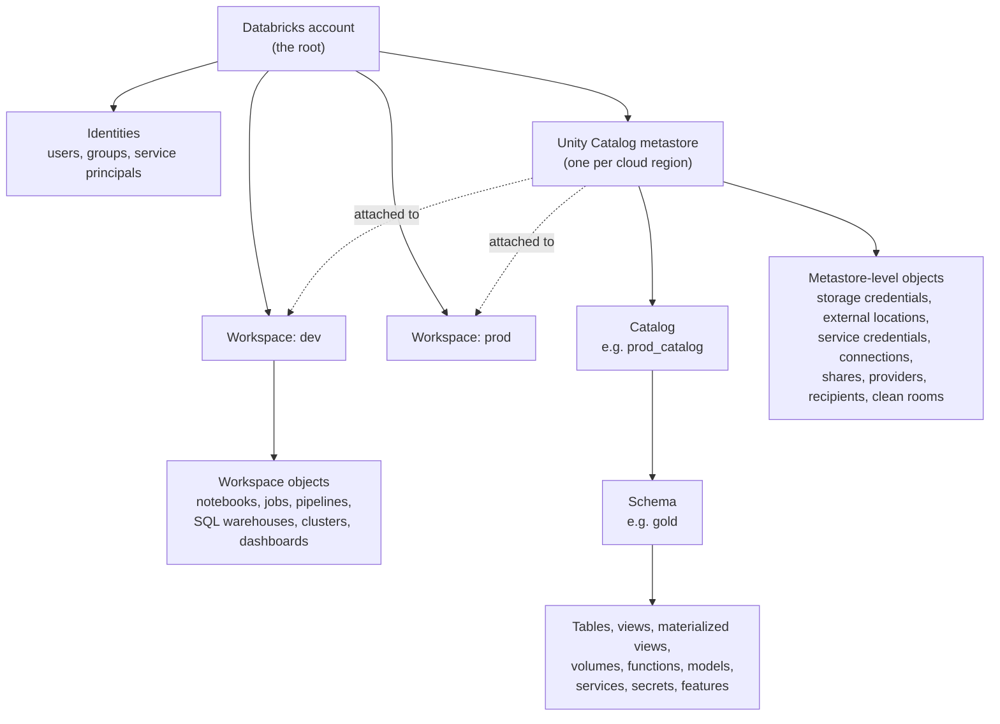
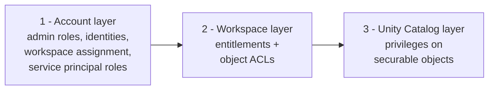
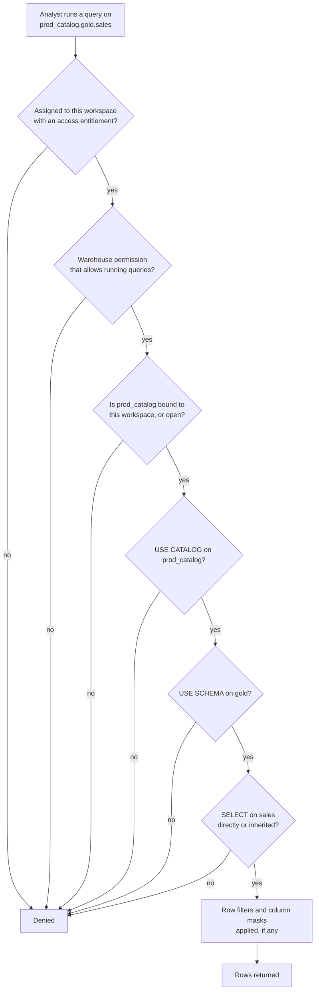
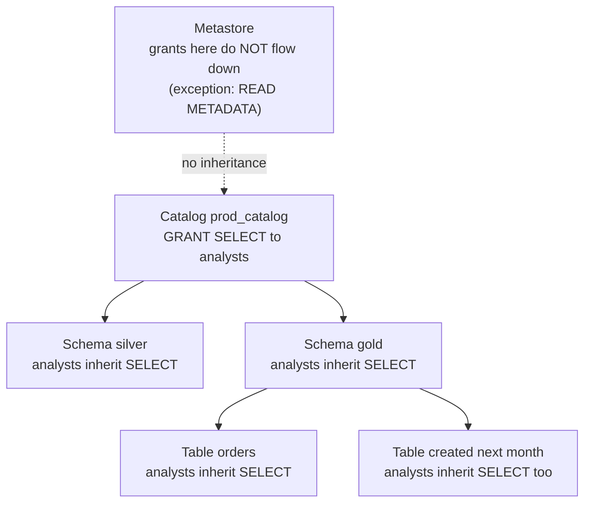

# Permissions Reference

General Databricks permissions reference: the account / workspace / Unity Catalog
hierarchy, every permission level, recipes, permissions as code and
troubleshooting. Not specific to this repo; for the identities this project
needs see [WORKSPACE_SETUP.md](WORKSPACE_SETUP.md), and for who owns what in
dev/prod see [MULTI_ENVIRONMENT_DEPLOYMENTS.md §4](MULTI_ENVIRONMENT_DEPLOYMENTS.md#4-dev-vs-prod).

> **Verified against the official docs on 19 October 2026.** Every section lists the page it comes from and that page's "last updated" date. Databricks changes this area often (several items below changed in 2026), so re-check the source links before relying on a detail for a production change.
>
> Scope: Unity Catalog-enabled workspaces, Premium plan or Free Edition. Checked against the GCP pages, which match AWS (this project's cloud) and Azure apart from cloud storage details; links point to the AWS pages.

---

## Contents

1. [The big picture in one minute](#1-the-big-picture-in-one-minute)
2. [The hierarchy: what contains what, and which is the root](#2-the-hierarchy-what-contains-what-and-which-is-the-root)
3. [The three permission layers](#3-the-three-permission-layers)
4. [How one query is checked, step by step](#4-how-one-query-is-checked-step-by-step)
5. [Layer 1: Account level (admin roles, identities)](#5-layer-1-account-level)
6. [Layer 2: Workspace level (entitlements and object ACLs)](#6-layer-2-workspace-level)
7. [Layer 3: Unity Catalog (securables and privileges)](#7-layer-3-unity-catalog)
8. [Complete Unity Catalog privilege reference](#8-complete-unity-catalog-privilege-reference)
9. [Common recipes](#9-common-recipes)
10. [Permissions as code: Terraform and bundles](#10-permissions-as-code-terraform-and-bundles)
11. [Troubleshooting `PERMISSION_DENIED`](#11-troubleshooting-permission_denied)
12. [Legacy, deprecated and recently changed items](#12-legacy-deprecated-and-recently-changed-items)
13. [Known inconsistencies in the official docs](#13-known-inconsistencies-in-the-official-docs)
14. [Sources](#14-sources)

---

## 1. The big picture in one minute

- The **Databricks account** is the root of everything. It holds your identities (users, groups, service principals), your **workspaces**, and your **Unity Catalog metastores**.
- A **workspace** is where people work: notebooks, jobs, pipelines, SQL warehouses, clusters, dashboards. These are protected by **workspace ACLs** (levels like `CAN VIEW`, `CAN RUN`, `CAN MANAGE`).
- A **metastore** is the root of all *data* governance. There is one per cloud region, and it can be attached to many workspaces in that region. Inside it: **catalog → schema → table/view/volume/function/model**. These are protected by **Unity Catalog privileges** (like `USE CATALOG`, `SELECT`, `MODIFY`).
- Unity Catalog privileges **flow down** from catalog to schema to objects, including objects created later. Grants on the metastore itself **do not** flow down.
- To do anything with data, a person usually needs to pass **all three layers**: be in the workspace (account layer), be allowed to use the compute (workspace layer), and hold the data privileges (Unity Catalog layer).

---

## 2. The hierarchy: what contains what, and which is the root



**How to read it:** solid arrows mean "contains". Dotted arrows mean "is attached to": the metastore is not inside a workspace; it sits beside workspaces and is shared by every workspace attached to it.

### Which is the root?

| Question | Answer |
|---|---|
| Root of the whole platform | The **Databricks account** (managed at `https://accounts.cloud.databricks.com` on AWS; Free Edition has no account console). Only account admins can create workspaces and metastores. |
| Root of data governance | The **metastore**. The docs call it the top-level securable object in Unity Catalog. |
| Root of your data namespace | The **catalog**: the first part of `catalog.schema.table`. |
| Root of workspace objects | The **workspace** itself; inside it, the folder tree. |

### Each level at a glance

| Level | Lives under | Scope | What it holds | Protected by |
|---|---|---|---|---|
| Account | (top) | Your whole Databricks subscription | Identities, workspaces, metastores, account settings | Account admin role |
| Workspace | Account | One deployment, tied to a cloud account and region | Notebooks, jobs, pipelines, warehouses, clusters, dashboards | Entitlements + workspace ACLs |
| Metastore | Account | One cloud region; shared by all attached workspaces in that region | Catalogs and all governance objects | Metastore-level UC privileges |
| Catalog | Metastore | First namespace level | Schemas | UC privileges (inherited down) |
| Schema | Catalog | Second namespace level | Tables, views, volumes, functions, models, services, secrets, features | UC privileges (inherited down) |
| Table, view, volume, ... | Schema | Third namespace level | The data itself | UC privileges |

Important consequence of the metastore being shared: a privilege granted in one workspace is effective in every other workspace attached to the same metastore. To stop prod data being reachable from dev, use **workspace-catalog binding** ([section 7.6](#76-workspace-catalog-binding)).

---

## 3. The three permission layers

Databricks has three separate permission systems. They protect different things and are managed with different tools.



| | Account layer | Workspace layer | Unity Catalog layer |
|---|---|---|---|
| Protects | The account, workspaces, identities, metastore setup | Things inside a workspace: compute, code, jobs, dashboards | Data and governance objects |
| Model | Roles (account admin, workspace admin, metastore admin, SP roles) | **Entitlements** (feature access) + **ACLs** (fixed ladder of levels per object) | **Privileges** you combine, inherited down the tree |
| Example | Make a group the metastore admin | Give `bi-analysts` `CAN USE` on a warehouse | Give `bi-analysts` `SELECT` on `prod_catalog.gold` |
| Terraform | `databricks_mws_permission_assignment`, `databricks_access_control_rule_set` | `databricks_entitlements`, `databricks_permissions` | `databricks_grants`, `databricks_grant` |

**Why both workspace ACLs and Unity Catalog privileges exist:** a warehouse is a piece of *compute* inside one workspace; a table is a piece of *data* in the metastore, shared across workspaces. `CAN USE` on a warehouse lets you run queries but does not let you read a single table. `SELECT` on a table lets you read it but does not give you any compute. You need both.

---

## 4. How one query is checked, step by step

Example: an analyst runs `SELECT * FROM prod_catalog.gold.sales` on a SQL warehouse in the prod workspace.



In plain words:

1. **Account layer.** The person must be assigned to the workspace and have at least one access entitlement (for example *Databricks SQL access*).
2. **Workspace layer.** They need a warehouse permission that includes "run queries": `CAN USE`, `CAN MONITOR`, `IS OWNER` or `CAN MANAGE` (see [6.3](#sql-warehouses)).
3. **Unity Catalog layer.**
   - The catalog must be reachable from this workspace (binding). Binding overrides grants: even an explicit `SELECT` doesn't help in an unbound workspace.
   - `USE CATALOG` on the catalog **and** `USE SCHEMA` on the schema **and** `SELECT` on the table (granted directly or inherited from the schema or catalog). All three are required.
   - Finally, any row filter or column mask (table-level or via ABAC policies) shapes what they see.

---

## 5. Layer 1: Account level

### 5.1 Admin roles

| Role | Scope | Required? | What it does |
|---|---|---|---|
| **Account admin** | Entire account | Yes | Creates workspaces and metastores, links metastores to workspaces, manages identities, assigns the account admin, workspace admin and metastore admin roles, configures storage credentials, enables system tables and OpenSharing |
| **Workspace admin** | One workspace | Yes | Manages workspace membership, compute, settings, job ownership and *Run as*, and has `CAN MANAGE` on every object in the workspace. In workspaces created after 6 March 2024, also gets default metastore privileges (below) |
| **Metastore admin** | One metastore | **Optional** | Owns the metastore. Can manage privileges and ownership of *any* object in it, which gives indirect access to all data (by transferring ownership to themselves; audit-logged) |
| **Marketplace admin** | Account | Optional | Manages the account's Databricks Marketplace provider profile and listings |

Key facts:

- The account admin who creates a workspace automatically becomes its workspace admin. Other account admins have no workspace access by default, but can assign themselves.
- Workspace admins are the members of the workspace's `admins` system group.
- When an account admin creates a metastore manually, they become its owner and initial metastore admin. A metastore provisioned through *automatic* Unity Catalog enablement has **no** metastore admin.
- Databricks recommends assigning the metastore admin role to a **group**.
- Account admins can limit workspace admins with the `RestrictWorkspaceAdmins` setting.

**Default workspace admin privileges** (workspaces enabled for Unity Catalog automatically, i.e. created after 6 March 2024), granted on the attached metastore:
`CREATE CATALOG`, `CREATE EXTERNAL LOCATION`, `CREATE SERVICE CREDENTIAL`, `CREATE STORAGE CREDENTIAL`, `CREATE CONNECTION`, `CREATE SHARE`, `CREATE RECIPIENT`, `CREATE PROVIDER`, `CREATE MATERIALIZED VIEW`.
These appear in the metastore's Permissions tab as an auto-generated group named `_workspace_admins_databricks_<account_id>_workspace_<workspace_id>`. They don't carry over to other workspaces attached to the same metastore.

Workspace admins also own the **workspace catalog** (if one was provisioned). All workspace users get `USE CATALOG` on it, plus `USE SCHEMA`, `CREATE TABLE`, `CREATE VOLUME`, `CREATE MODEL`, `CREATE FUNCTION` and `CREATE MATERIALIZED VIEW` on its `default` schema.

**When you still need a metastore admin** (even in newer workspaces): to change ownership of, or grant on, objects you don't own (for example taking over a catalog after its owner left); to remove the default workspace-admin privileges; to add managed storage to a metastore that has none; and to enable default access-request destinations.

**Default metastore admin privileges** on the metastore:
`CREATE CATALOG`, `CREATE CLEAN ROOM`, `CREATE CONNECTION`, `CREATE EXTERNAL LOCATION`, `CREATE SERVICE CREDENTIAL`, `CREATE STORAGE CREDENTIAL`, `CREATE FOREIGN CATALOG`, `CREATE SHARE`, `CREATE RECIPIENT`, `CREATE PROVIDER`, `CREATE MATERIALIZED VIEW`, `MANAGE ALLOWLIST`.
On top of these, as the metastore's owner: manage privileges and ownership of any object; read and update metadata of all objects; set tags on all objects; configure access request destinations; delete the metastore.

### 5.2 Identities

- Three kinds of principal: **users**, **groups**, **service principals**.
- With Unity Catalog enabled, manage identities **in the account console**, then assign them to workspaces. Workspace-local groups are legacy; Unity Catalog grants need account-level groups (see [section 12](#12-legacy-deprecated-and-recently-changed-items)).
- A service principal can be given the same things as a user: account admin, workspace admin, Unity Catalog privileges, group membership.

How to name each principal:

| Principal | SQL | Bundle YAML | Terraform |
|---|---|---|---|
| User | `` `user@company.com` `` | `user_name:` | user name (email) |
| Group | `` `data-engineers` `` | `group_name:` | group display name |
| Service principal | its **application ID** `` `a1b2c3d4-1111-…` `` | `service_principal_name:` (application ID) | `application_id` |

Wrap names containing `@`, `-` or spaces in backticks. Grant to **groups**, not individuals, and run production jobs as a **service principal**.

### 5.3 Service principal roles (account level)

These control who can *use* or *manage* a service principal itself.

| Role | API name | What it allows |
|---|---|---|
| Service Principal: Manager | `roles/servicePrincipal.manager` | Manage roles on the service principal. The creator of a service principal gets this automatically |
| Service Principal: User | `roles/servicePrincipal.user` | Use the service principal's identity, for example as a job's *Run as* |

The Manager role does **not** include the User role. If you create a service principal and want to run jobs as it, assign yourself the User role explicitly.

---

## 6. Layer 2: Workspace level

### 6.1 Entitlements (what parts of the workspace someone can use)

An entitlement is assigned at the workspace level and switches on a set of features. A user needs **at least one access entitlement** to get into a workspace. Entitlements require the Premium plan.

| Entitlement | API name | Grants |
|---|---|---|
| Consumer access | `workspace-consume` | A simplified UI to view shared dashboards, Genie Agents and Databricks Apps; query SQL warehouses from BI tools; query Unity Gateway services |
| Databricks SQL access | `databricks-sql-access` | Databricks SQL: dashboards, queries, SQL warehouses; query warehouses from BI tools |
| Workspace access | `workspace-access` | Core workspace: notebooks, jobs, models, pipelines |
| Allow unrestricted cluster creation | `allow-cluster-create` | Create unrestricted clusters **and SQL warehouses** |
| Allow pool creation | `allow-instance-pool-create` | Create instance pools |

Defaults:

- Workspace admins always have Workspace access, unrestricted cluster creation and pool creation (cannot be removed). They also get Databricks SQL access by default (removable).
- **Changed in 2026:** Previously, every workspace user got Workspace access and Databricks SQL access through the `users` group. Under the new behavior, entitlements are chosen explicitly when a principal is added to a workspace. The `users` group carries no entitlements, the `admins` group carries all of them, and both are locked. Existing entitlements on `users` were migrated to a workspace-local clone group. The rollout started 15 June 2026, was auto-enabled 27 July 2026, and is **enforced for all workspaces from 14 September 2026**.

### 6.2 Workspace ACLs: general rules

- Workspace admins have `CAN MANAGE` on **all** objects in their workspace.
- Whoever creates an object gets `CAN MANAGE` on it.
- **Folders pass permissions down:** objects in a folder inherit the folder's permissions. If you grant access to an object inside a folder, the person can see the parent folder's *name*, but nothing else in it.
- The UI says **CAN VIEW** where the Permissions API (and Terraform) says **CAN_READ** for the same level, for notebooks, files, folders and dashboards.
- **Upcoming change:** members will inherit workspace object permissions from **all** account groups they belong to, even groups not assigned to the workspace. Databricks provides an "Orphaned permissions analysis" notebook to review grants before this lands.

### 6.3 Workspace ACLs: every object type, lowest to highest

Each table lists the levels in order from least to most access, and what each level **adds** on top of the previous one. Where a level is not a strict superset of the one before it, this is called out.

#### SQL warehouses

> **Not a simple ladder.** `CAN VIEW` and `CAN USE` cover *different* abilities, and `CAN MONITOR` covers both.

| Ability | CAN VIEW | CAN MONITOR | CAN USE | IS OWNER | CAN MANAGE |
|---|:-:|:-:|:-:|:-:|:-:|
| View warehouse details | ✓ | ✓ | ✓ | ✓ | ✓ |
| View warehouse queries (query history) | ✓ | ✓ | | ✓ | ✓ |
| View warehouse monitoring tab | ✓ | ✓ | | ✓ | ✓ |
| Start the warehouse | | ✓ | ✓ | ✓ | ✓ |
| Run queries | | ✓ | ✓ | ✓ | ✓ |
| Stop the warehouse | | | | ✓ | ✓ |
| Edit the warehouse | | | | ✓ | ✓ |
| Delete the warehouse | | | | ✓ | ✓ |
| Modify permissions | | | | ✓ | ✓ |

In plain words:
- `CAN VIEW`: an observer. Sees the warehouse, its query history and monitoring, but can't run anything.
- `CAN USE`: a user. Can start it and run queries, but can't see other people's queries. **This is the right level for BI tools and analysts.**
- `CAN MONITOR`: both of the above. Useful for support or platform on-call.
- `IS OWNER` and `CAN MANAGE`: full control. A warehouse has exactly one owner, which can't be a group.
- Creating a warehouse requires being a workspace admin or having *Allow unrestricted cluster creation*.

#### Compute (clusters)

| Level | Adds |
|---|---|
| CAN VIEW *(Beta; needs the "Can view compute permission" workspace preview)* | View Spark UI and compute metrics |
| CAN ATTACH TO | Attach notebooks to the compute |
| CAN RESTART | Start, restart and terminate the compute |
| CAN MANAGE | Edit, resize, attach libraries, modify permissions, and view driver logs |

By default, Spark driver logs are visible only with `CAN MANAGE` (on dedicated or standard access mode). This is because secrets are not redacted from driver stdout/stderr. You can relax it per compute with `spark.databricks.acl.needAdminPermissionToViewLogs false`. On legacy *No isolation shared* compute, lower levels can see logs and cloud credentials in log4j, so be careful.

#### Jobs

| Level | Adds |
|---|---|
| CAN VIEW | View job details, settings and results |
| CAN MANAGE RUN | View Spark UI and run logs; Run now (also with different parameters); cancel runs |
| IS OWNER | Edit settings, delete the job, modify permissions |
| CAN MANAGE | Same abilities as IS OWNER |

Rules: the creator is the owner by default; a job has exactly one owner, and a group can't be owner. **Run now executes with the owner's permissions, not the clicker's.** Job ACLs don't apply to notebook workflows (they use the notebook's permissions) or to jobs submitted through the API without an explicit `access_control_list`.

**Owner and run-as identity.** Job ACLs decide who can *act on* the job; the run-as identity decides what the run can *touch*:

```
user clicks "Run now"            ← needs job ACL: CAN MANAGE RUN
        │
        ▼
job runs AS <run-as identity>    ← job setting (default: the owner)
        │
        ▼
reads/writes cat.bronze.events   ← needs UC privileges on the run-as identity,
                                   not on the user who clicked
```

| Fact | Detail |
|---|---|
| Who can change the owner | Workspace admins only |
| Who can change run-as | `CAN MANAGE` or `IS OWNER` on the job |
| Run as a service principal | You need the **Service Principal: User** role on it ([5.3](#53-service-principal-roles-account-level)) |
| Run as a group | Account group assigned to the workspace, and you're a member. Not `admins`, `users`, `account users` or workspace-local groups |
| When privileges are checked | Job ACLs when you act on the job; run-as privileges **during** the run (revoking mid-run can fail it) |
| SQL query / alert tasks | *Run as owner* uses the query owner; *Run as viewer* uses the job's run-as |

Production: run as a service principal, `CAN VIEW` for observers, `CAN MANAGE RUN` for operators, `CAN MANAGE` only for people trusted to change production code.

#### Lakeflow pipelines

| Level | Adds |
|---|---|
| CAN VIEW | View pipeline details, list pipelines, view Spark UI and driver logs |
| CAN RUN | Start and stop pipeline updates; stop pipeline clusters |
| CAN MANAGE | Edit settings, delete, purge runs and experiments, modify permissions |
| IS OWNER | Same abilities as CAN MANAGE; exactly one owner, not a group |

#### Notebooks

| Level (API name) | Adds |
|---|---|
| CAN VIEW (`CAN_READ`) | View cells, comment, run it from another notebook with `%run` or notebook workflows |
| CAN RUN | Attach and detach; run commands |
| CAN EDIT | Edit cells |
| CAN MANAGE | Modify permissions |

#### Files (workspace files)

| Level (API name) | Adds |
|---|---|
| CAN VIEW (`CAN_READ`) | Read, comment |
| CAN RUN | Attach and detach, run interactively |
| CAN EDIT | Edit |
| CAN MANAGE | Modify permissions |

#### Folders

With **no permission**, anyone can list a folder's objects.

| Level (API name) | Adds |
|---|---|
| CAN VIEW (`CAN_READ`) | View objects in the folder |
| CAN EDIT | Clone and export items |
| CAN RUN | Run objects in the folder |
| CAN MANAGE | Create, import, delete, move and rename items; modify permissions |

> Note: the official table puts CAN EDIT *before* CAN RUN for folders, and as documented CAN EDIT does not include running. This differs from notebooks and files. It's reproduced exactly as published; test it before relying on it.

#### Git folders

| Level | Adds |
|---|---|
| CAN READ | View, clone and export assets |
| CAN RUN | Run executable assets |
| CAN EDIT | Edit and rename assets |
| CAN MANAGE | Create, switch, pull and push branches; create, import, delete and move assets; modify permissions |

#### Dashboards (AI/BI)

| Level (API name) | Adds |
|---|---|
| CAN VIEW (`CAN_READ`) | View dashboard, results and datasets; interact with widgets; refresh; clone |
| CAN RUN | Same abilities as CAN VIEW in the current table |
| CAN EDIT | Edit; publish a dashboard snapshot |
| CAN MANAGE | Modify permissions; delete |

#### Queries

| Level | Adds |
|---|---|
| CAN VIEW | See it in the list; view text and results |
| CAN RUN | Refresh results or choose parameters; include in a dashboard; change SQL warehouse or data source |
| CAN EDIT | Edit query text |
| CAN MANAGE | Modify permissions; delete |

For queries in the **legacy SQL editor**, changing the warehouse or data source needs CAN MANAGE.

#### Alerts

| Level | Adds |
|---|---|
| CAN RUN | See in list, view alert and result, trigger manually, subscribe |
| CAN MANAGE | Edit, modify permissions, delete |

#### Genie Agents (formerly Genie spaces)

| Level | Adds |
|---|---|
| CAN VIEW | See in list, ask questions, give feedback, upload files to a conversation |
| CAN RUN | Same abilities as CAN VIEW |
| CAN EDIT | Edit instructions and sample questions; add or remove tables |
| CAN MANAGE | Monitor the space, view other users' conversations, modify permissions, delete |

#### Genie Code chat threads

| Level | Adds |
|---|---|
| CAN VIEW | View the thread |
| CAN MANAGE | Add prompts, edit, copy, rename, delete, modify permissions |

#### Model serving endpoints

| Level | Adds |
|---|---|
| CAN VIEW | Get and list the endpoint |
| CAN QUERY | Query the endpoint |
| CAN MANAGE | Update config, delete, modify permissions |

#### AI Search endpoints (Vector Search)

| Level | Adds |
|---|---|
| CAN CREATE | Get, list and create endpoints |
| CAN USE | Use an endpoint (create an index) |
| CAN MANAGE | Delete, modify permissions |

#### MLflow experiments

- **Notebook experiments** follow the notebook's permissions (CAN READ < CAN RUN < CAN EDIT < CAN MANAGE). Changing one changes the other.
- **Workspace experiments:**

| Level | Adds |
|---|---|
| CAN READ | View the experiment |
| CAN EDIT | Log runs; edit the experiment |
| CAN MANAGE | Delete; modify permissions |

#### Instance pools

| Level | Adds |
|---|---|
| CAN ATTACH TO | Attach a cluster to the pool |
| CAN MANAGE | Edit, delete, modify permissions |

#### Secret scopes (workspace secrets)

| Level | Adds |
|---|---|
| READ | Read the scope and list its secrets |
| WRITE | Write to the scope |
| MANAGE | Modify permissions |

(Unity Catalog also has its own *secret* securable with `READ SECRET` / `WRITE SECRET` / `REFERENCE SECRET`; see [section 8](#8-complete-unity-catalog-privilege-reference).)

#### Lakebase (Autoscaling) projects

Workspace admins automatically have CAN MANAGE. Every workspace user automatically has CAN CREATE (it can't be assigned or removed). You grant others CAN USE or CAN MANAGE.

| Level | Adds (summary) |
|---|---|
| CAN CREATE | View and list projects, branches, endpoints and operations; create projects |
| CAN USE | View connection URI; create, delete and update branch databases and roles; view and reset role passwords; create snapshots and set schedules |
| CAN MANAGE | Everything else: delete and update projects; create, delete, reset and restore branches; manage endpoints (create, start, stop, restart, update); delete, update and restore snapshots |

#### Other objects (levels from the Terraform provider docs)

| Object | Levels |
|---|---|
| Cluster policies | CAN USE |
| Databricks Apps | CAN USE < CAN MANAGE |
| Personal access tokens (`authorization = "tokens"`) | CAN USE (non-admins); admins have CAN MANAGE |

#### Legacy workspace objects (non-Unity Catalog workspaces only)

| Object | Levels | Use instead |
|---|---|---|
| Workspace Model Registry models | CAN READ < CAN EDIT < CAN MANAGE STAGING VERSIONS < CAN MANAGE PRODUCTION VERSIONS < CAN MANAGE | Models in Unity Catalog |
| Workspace Feature Store feature tables | CAN VIEW METADATA < CAN EDIT METADATA < CAN MANAGE | Features and tables in Unity Catalog |

---

## 7. Layer 3: Unity Catalog

### 7.1 Securable objects

A **securable** is anything in Unity Catalog you can grant privileges on.

**Inside the namespace** (`catalog.schema.object`):

| Securable | What it is |
|---|---|
| Catalog | Top level of your data; usually split by environment or business unit. A **container** |
| Schema | Groups objects by project, domain or team. A **container** |
| Table | Structured data: managed, external, or foreign (from a federated system; read-only) |
| View | A saved query. Readers need `SELECT` on the view only; the view owner's rights resolve the underlying tables |
| Materialized view | A view with stored results; adds the `REFRESH` privilege |
| Metric view | Reusable metric definitions; same permission model as views |
| Volume | Unstructured files in cloud storage (managed or external) |
| Function | UDFs, stored procedures, and registered models (in Unity Catalog, a model is a type of function) |
| Model | MLflow model with versions |
| Service *(Beta)* | Governed AI endpoints: model services, model provider services, MCP services, agent services |
| Secret | A governed credential or token |
| Feature *(Public Preview)* | A stored ML feature definition |

**Directly under the metastore** (not inside a catalog):

| Securable | What it is |
|---|---|
| Storage credential | Authentication to cloud storage (on AWS, an IAM role) |
| External location | A cloud storage path plus the storage credential to reach it |
| Service credential | Authentication to external cloud services |
| Connection | Endpoint and credentials for an external database or service (federation, ingestion, JDBC, HTTP) |
| External metadata | Custom lineage for systems outside Unity Catalog |
| Share | A bundle of assets to share via OpenSharing |
| Provider | An organization that shares data with you |
| Recipient | An organization you share data with (no privileges can be granted on it) |
| Clean room | A secure collaboration space with another organization |

### 7.2 How privileges flow (inheritance)



Rules, in plain words:

1. **Down, not up.** A privilege granted on a catalog applies to every schema in it and every object in those schemas. A privilege on a schema applies to every object in that schema.
2. **Future objects included.** Inheritance covers objects created *after* the grant. That's convenient, but it also means a catalog-level grant is broad.
3. **Metastore grants don't flow down.** `CREATE CATALOG` on the metastore lets you create catalogs, not read data in them. The single exception is `READ METADATA`, which flows down to everything from the metastore.
4. **Denials flow down too.** If a privilege is denied on a parent (through an ABAC DENY policy), it's denied on all children.
5. **Ownership doesn't flow down.** Owning a catalog doesn't make you the owner of its schemas, but you can *manage* all of them (see 7.4).

### 7.3 Usage privileges: the "doors"

`USE CATALOG` and `USE SCHEMA` don't give access to data on their own. They are the doors you must pass through to reach anything inside. To read a table you need **all three**:

1. `USE CATALOG` on the catalog
2. `USE SCHEMA` on the schema
3. `SELECT` on the table (direct or inherited)

Why this matters: only catalog and schema owners (or holders of `MANAGE`) can grant these usage privileges. So even if a table owner grants `SELECT` to someone, that person can't reach the table unless the catalog and schema owners also let them through. The catalog owner always keeps final control.

| Operation | Needs |
|---|---|
| Read a table or view | `USE CATALOG` + `USE SCHEMA` + `SELECT` |
| Write to a table | `USE CATALOG` + `USE SCHEMA` + `MODIFY` (and `SELECT`, per the privilege reference) |
| Create a schema | `USE CATALOG` + `CREATE SCHEMA` on the catalog |
| Create a table | `USE CATALOG` + `USE SCHEMA` + `CREATE TABLE` on the schema (or catalog) |
| Run a function | `USE CATALOG` + `USE SCHEMA` + `EXECUTE` |
| Read files in a volume | `USE CATALOG` + `USE SCHEMA` + `READ VOLUME` |
| Manage a catalog | `MANAGE` on the catalog (no usage privileges needed) |
| Manage a schema | `USE CATALOG` + `MANAGE` on the schema |
| Manage a table, view, volume or function | `USE CATALOG` + `USE SCHEMA` + `MANAGE` on the object |

`BROWSE` is the one way to *see* objects without the doors: it shows names, descriptions and tags, and lets people request access, without `USE CATALOG` or `USE SCHEMA`.

### 7.4 Ownership vs MANAGE vs ALL PRIVILEGES

Every securable has exactly **one owner**: a user, service principal or group. Whoever creates an object becomes its owner.

| Capability | Owner | `MANAGE` | `ALL PRIVILEGES` |
|---|---|---|---|
| Use the object (read, write, etc.) | Yes, implied | **No** (but can grant it to themselves) | Yes |
| Grant and revoke privileges on it | Yes | Yes | No |
| Transfer ownership | Yes | Yes | No |
| Drop it | Yes | Yes | No |
| Manage child objects | Yes, implied | Yes (`MANAGE` is inherited by children) | n/a |
| How many principals | Exactly one | Many | Many |
| Shows in `SHOW GRANTS` | No (ownership is separate) | Yes | Yes (only as `ALL PRIVILEGES`, not expanded) |

Important details:

- **`ALL PRIVILEGES` excludes** `MANAGE`, `READ METADATA`, `EXTERNAL USE SCHEMA` and `EXTERNAL USE LOCATION`, to prevent privilege escalation and data exfiltration.
- **`ALL PRIVILEGES` grows over time.** It's evaluated at check time, so when Databricks adds new privileges, existing `ALL PRIVILEGES` grants include them automatically. In production, list privileges explicitly.
- **Owners don't get the external-use privileges.** Schema owners don't have `EXTERNAL USE SCHEMA` by default, and external location owners don't have `EXTERNAL USE LOCATION`.
- **`MANAGE` needs fewer doors.** `MANAGE` on a catalog needs no usage privileges at all. `MANAGE` on a schema needs `USE CATALOG` only. This applies to management capabilities only; reading data with `SELECT` still needs both usage privileges.

### 7.5 Composite and child privileges

Some privileges have smaller "child" privileges so you can delegate part of the power. Composite and child privileges are granted and revoked **independently**: granting the composite doesn't grant the children, and revoking the composite doesn't remove an explicitly granted child.

| Composite | Children |
|---|---|
| `MANAGE` | `READ METADATA` (read-only view of everything an owner sees); `MANAGE ACCESS CONTROL` (can only be *denied* via ABAC DENY policies, not granted) |
| `MODIFY` | `INSERT`, `UPDATE`, `DELETE` *(Beta)* |

### 7.6 Workspace-catalog binding

By default, a catalog is reachable from **every** workspace attached to the metastore. Binding restricts it to chosen workspaces, optionally **read-only**.

- **Binding beats grants:** from an unbound workspace, access is denied even with explicit privileges.
- Can be bound: **catalogs**, **external locations**, **storage credentials**.
- Who can change bindings: metastore admin, catalog owner, or `MANAGE` on the catalog. `READ METADATA` lets you view bindings.
- In the CLI/API, a catalog's isolation mode is `OPEN` (default) or `ISOLATED`. Binding types are `BINDING_TYPE_READ_WRITE` (default) and `BINDING_TYPE_READ_ONLY`.
- The default **workspace catalog** in new workspaces is bound only to its own workspace from the start.
- Databricks' developer best practices recommend binding the production catalog in `ISOLATED` mode to the production workspace only.

### 7.7 Attribute-based access control (ABAC)

ABAC lets you write a policy once and have it apply wherever data carries a matching **governed tag**.

- Policies attach at the **catalog, schema or table** level, or at the **metastore** level *(Beta)*.
- Policy types: **row filter** and **column mask** policies; **GRANT** policies (dynamic grants); **DENY** policies *(Beta)*, which deny `MANAGE ACCESS CONTROL`.
- Grants and denials made through ABAC follow the same downward inheritance as normal grants.
- Applying a governed tag needs `APPLY TAG` on the object **and** `ASSIGN` on the governed tag.

### 7.8 SQL syntax and ownership transfer

```sql
GRANT <privilege>[, <privilege>…] ON <securable-type> <name> TO <principal>;
REVOKE <privilege> ON <securable-type> <name> FROM <principal>;  -- succeeds even if not granted

SHOW GRANTS ON SCHEMA cat.bronze;                    -- everyone (owner / MANAGE / READ METADATA / admin)
SHOW GRANTS `data-engineers` ON SCHEMA cat.bronze;   -- one principal

ALTER SCHEMA cat.bronze OWNER TO `data-engineers`;
GRANT CREATE CATALOG ON METASTORE TO `platform-admins`;  -- no name: the attached metastore
GRANT EXECUTE ON FUNCTION cat.ml.churn_model TO `ml-serving`;  -- models are functions
```

Who can transfer ownership: the current owner, the parent container's owner, `MANAGE` holders and metastore admins. For **views, functions and models**, non-metastore-admins can transfer only to themselves or a group they belong to. For **pipeline** materialized views and streaming tables, change the pipeline's run-as; ownership follows on the next refresh.

---

## 8. Complete Unity Catalog privilege reference

Privileges are listed by purpose. "Where" means the securables on which the privilege can be granted. When a privilege is granted on a catalog or schema, it applies to all current and future matching objects inside.

In SQL, privileges are written with spaces (`USE CATALOG`). In Terraform and the API, use underscores (`USE_CATALOG`).

### 8.1 Usage (doors)

| Privilege | Where | What it allows |
|---|---|---|
| `USE CATALOG` | Catalog | Required to interact with anything in the catalog. Gives no data access on its own |
| `USE SCHEMA` | Schema, catalog | Required to interact with anything in the schema. Gives no data access on its own |

### 8.2 Read

| Privilege | Where | What it allows |
|---|---|---|
| `SELECT` | Table, view, materialized view, share; schema, catalog | Query data. On a share: lets a recipient read it |
| `READ VOLUME` | Volume; schema, catalog | Read files in a volume |
| `EXECUTE` | Function (incl. models), service; schema, catalog | Call a function or invoke a service; for models, load for inference, view all version metadata and download files |
| `REFRESH` | Materialized view; schema, catalog | Trigger a refresh |
| `READ FEATURE` | Feature; schema, catalog | Read a feature's metadata and use it for training and inference (the underlying data also needs `SELECT`) |
| `READ FILES` | External location | Read files directly from the path. **Discouraged**: use volumes and `READ VOLUME` instead |

### 8.3 Write

| Privilege | Where | What it allows |
|---|---|---|
| `MODIFY` | Table, external metadata; schema, catalog | Insert, update and delete table data (also needs `SELECT`). On external metadata: add lineage relationships. Not grantable on foreign tables |
| `INSERT` *(Beta)* | Table; schema, catalog | Add rows only |
| `UPDATE` *(Beta)* | Table; schema, catalog | Change existing rows only |
| `DELETE` *(Beta)* | Table; schema, catalog | Delete rows only |
| `WRITE VOLUME` | Volume; schema, catalog | Add, change and remove files in a volume |
| `WRITE FILES` | External location | Write files directly to the path. Only works together with `READ FILES`. **Discouraged**: use volumes |

### 8.4 Create

| Privilege | Where | What it allows |
|---|---|---|
| `CREATE CATALOG` | Metastore | Create catalogs |
| `CREATE SCHEMA` | Catalog | Create schemas |
| `CREATE TABLE` | Schema, catalog | Create tables **and views** |
| `CREATE MATERIALIZED VIEW` | Schema, catalog (also listed among metastore-level defaults) | Create materialized views |
| `CREATE VOLUME` | Schema, catalog | Create volumes |
| `CREATE FUNCTION` | Schema, catalog | Create functions |
| `CREATE MODEL` | Schema, catalog | Create registered models |
| `CREATE MODEL VERSION` | Model | Register new versions (without execute, modify or tag rights) |
| `CREATE FEATURE` | Schema, catalog | Create features |
| `CREATE SECRET` | Schema, catalog | Create Unity Catalog secrets |
| `CREATE SERVICE` | Schema, catalog | Create services (model, model provider, MCP, agent) |
| `CREATE STORAGE CREDENTIAL` | Metastore | Create storage credentials |
| `CREATE EXTERNAL LOCATION` | Metastore **and** storage credential (both needed) | Create external locations |
| `CREATE EXTERNAL TABLE` | External location, storage credential | Create external tables at a path. Prefer granting on an external location (path-scoped) |
| `CREATE EXTERNAL VOLUME` | External location | Create external volumes |
| `CREATE MANAGED STORAGE` | External location | Set a custom managed storage location when creating a catalog or schema |
| `CREATE SERVICE CREDENTIAL` | Metastore | Create service credentials |
| `CREATE CONNECTION` | Metastore; service credential | Create connections (both are needed if the connection uses a service credential) |
| `CREATE FOREIGN CATALOG` | Connection (also metastore) | Create foreign catalogs through a connection |
| `CREATE FOREIGN SECURABLE` | External location | Set authorized paths when creating a foreign catalog |
| `CREATE EXTERNAL METADATA` | Metastore | Create external metadata objects for custom lineage |
| `CREATE CLEAN ROOM` | Metastore | Create clean rooms |
| `CREATE SHARE` | Metastore | Create shares |
| `CREATE RECIPIENT` | Metastore | Create recipients |
| `CREATE PROVIDER` | Metastore | Create providers |

### 8.5 Discovery, metadata and tags

| Privilege | Where | What it allows |
|---|---|---|
| `BROWSE` | Catalog (for data objects); external location, external metadata, clean room | See that objects exist, with names, descriptions and tags, and request access. No usage privileges needed. Databricks recommends granting it on catalogs to `All account users` |
| `READ METADATA` | Metastore, catalog, schema; tables, views, volumes, functions, features, services, credentials, locations, connections, clean rooms, external metadata | See *all* metadata an owner sees (grants, row filters, column masks, ABAC policies, view and function definitions, credential details) without modify or data access. For auditors and governance teams. Not included in `ALL PRIVILEGES` |
| `APPLY TAG` | Table, view, materialized view, volume, model, secret, service, external metadata; schema, catalog | Add and edit tags (including column tags on tables and version tags on models) |

### 8.6 Administration

| Privilege | Where | What it allows |
|---|---|---|
| `MANAGE` | Catalog, schema, and most objects | Grant and revoke, transfer ownership, drop. **Not** data access by itself. Inherited by children |
| `ALL PRIVILEGES` | Catalog, schema, and most objects | Every applicable privilege, except `MANAGE`, `READ METADATA`, `EXTERNAL USE SCHEMA` and `EXTERNAL USE LOCATION` |
| `MANAGE ALLOWLIST` | Metastore | Control which init scripts, JARs and Maven packages can run on standard-access clusters. Keep it for platform admins |

### 8.7 Secrets (Unity Catalog secrets)

| Privilege | Where | What it allows |
|---|---|---|
| `READ SECRET` | Secret; schema, catalog | Read a secret value (from notebooks, jobs or the API) |
| `WRITE SECRET` | Secret; schema, catalog | Update a secret value |
| `REFERENCE SECRET` | Secret; schema, catalog | Let a Unity Catalog object use a secret without exposing the value |

### 8.8 External engines and services

| Privilege | Where | What it allows |
|---|---|---|
| `EXTERNAL USE SCHEMA` *(Public Preview)* | Schema | Temporary credentials so external engines can read tables via the Unity Catalog open APIs or Iceberg REST. Only the **catalog owner** can grant it |
| `EXTERNAL USE LOCATION` | External location | Temporary credentials for an external location from outside engines. Only holders of `MANAGE` on the location can grant it |
| `ACCESS` | Service credential | Use the service credential to reach an external service |
| `USE CONNECTION` | Connection | List and view connections; use them (including `remote_query`) |

### 8.9 Sharing, Marketplace and clean rooms

| Privilege | Where | What it allows |
|---|---|---|
| `USE SHARE` | Metastore | View all shares and their recipients (read-only) |
| `USE RECIPIENT` | Metastore | View all recipients (read-only) |
| `USE PROVIDER` | Metastore | View providers and their shares; with `CREATE CATALOG`, mount a share as a catalog |
| `SET SHARE PERMISSION` | Metastore | Grant recipients access to shares; transfer share ownership |
| `USE MARKETPLACE ASSETS` | Metastore | Get Marketplace data products (enabled by default) |
| `EXECUTE CLEAN ROOM TASK` | Clean room | Run notebooks in a clean room |
| `MODIFY CLEAN ROOM` | Clean room | Add and remove assets and notebooks; edit comments |

### 8.10 Privileges by securable (quick lookup)

| Securable | Privileges you can grant on it |
|---|---|
| **Metastore** | `CREATE CATALOG`, `CREATE CLEAN ROOM`, `CREATE CONNECTION`, `CREATE EXTERNAL LOCATION`, `CREATE EXTERNAL METADATA`, `CREATE FOREIGN CATALOG`, `CREATE MATERIALIZED VIEW`, `CREATE PROVIDER`, `CREATE RECIPIENT`, `CREATE SERVICE CREDENTIAL`, `CREATE SHARE`, `CREATE STORAGE CREDENTIAL`, `MANAGE ALLOWLIST`, `READ METADATA`, `SET SHARE PERMISSION`, `USE MARKETPLACE ASSETS`, `USE PROVIDER`, `USE RECIPIENT`, `USE SHARE` |
| **Catalog** | `ALL PRIVILEGES`, `APPLY TAG`, `BROWSE`, `CREATE FEATURE`, `CREATE FUNCTION`, `CREATE MATERIALIZED VIEW`, `CREATE MODEL`, `CREATE SCHEMA`, `CREATE SECRET`, `CREATE SERVICE`, `CREATE TABLE`, `CREATE VOLUME`, `DELETE`, `EXECUTE`, `INSERT`, `MANAGE`, `MODIFY`, `READ FEATURE`, `READ METADATA`, `READ SECRET`, `READ VOLUME`, `REFERENCE SECRET`, `REFRESH`, `SELECT`, `UPDATE`, `USE CATALOG`, `USE SCHEMA`, `WRITE SECRET`, `WRITE VOLUME` |
| **Schema** | Same as catalog **except** `BROWSE`, `CREATE SCHEMA`, `USE CATALOG`; **plus** `EXTERNAL USE SCHEMA` |
| **Table** | `ALL PRIVILEGES`, `APPLY TAG`, `DELETE`, `INSERT`, `MANAGE`, `MODIFY`, `READ METADATA`, `SELECT`, `UPDATE` |
| **View** | `ALL PRIVILEGES`, `APPLY TAG`, `MANAGE`, `READ METADATA`, `SELECT` |
| **Materialized view** | `ALL PRIVILEGES`, `APPLY TAG`, `MANAGE`, `READ METADATA`, `REFRESH`, `SELECT` |
| **Volume** | `ALL PRIVILEGES`, `APPLY TAG`, `MANAGE`, `READ METADATA`, `READ VOLUME`, `WRITE VOLUME` |
| **Function** | `ALL PRIVILEGES`, `EXECUTE`, `MANAGE`, `READ METADATA` |
| **Model** | As function, plus `APPLY TAG`, `CREATE MODEL VERSION` |
| **Service** | `APPLY TAG`, `EXECUTE`, `READ METADATA` |
| **Secret** | `APPLY TAG`, `READ SECRET`, `REFERENCE SECRET`, `WRITE SECRET` |
| **Feature** | `ALL PRIVILEGES`, `MANAGE`, `READ FEATURE`, `READ METADATA` |
| **Storage credential** | `ALL PRIVILEGES`, `CREATE EXTERNAL LOCATION`, `CREATE EXTERNAL TABLE`, `MANAGE`, `READ METADATA` |
| **External location** | `ALL PRIVILEGES`, `BROWSE`, `CREATE EXTERNAL TABLE`, `CREATE EXTERNAL VOLUME`, `CREATE FOREIGN SECURABLE`, `CREATE MANAGED STORAGE`, `EXTERNAL USE LOCATION`, `MANAGE`, `READ FILES`, `READ METADATA`, `WRITE FILES` |
| **Service credential** | `ACCESS`, `ALL PRIVILEGES`, `CREATE CONNECTION`, `MANAGE`, `READ METADATA` |
| **Connection** | `ALL PRIVILEGES`, `CREATE FOREIGN CATALOG`, `MANAGE`, `READ METADATA`, `USE CONNECTION` |
| **External metadata** | `ALL PRIVILEGES`, `APPLY TAG`, `BROWSE`, `MANAGE`, `MODIFY`, `READ METADATA` |
| **Share** | `SELECT` (granted to recipients) |
| **Clean room** | `BROWSE`, `EXECUTE CLEAN ROOM TASK`, `MANAGE`, `MODIFY CLEAN ROOM`, `READ METADATA` |
| **Recipient, provider** | None directly (controlled through metastore-level privileges and share grants) |

---

## 9. Common recipes

All examples use Unity Catalog SQL. Grant to **groups**, not individuals.

**Read-only analyst on one schema**
```sql
GRANT USE CATALOG ON CATALOG prod_catalog TO `bi-analysts`;
GRANT USE SCHEMA, SELECT ON SCHEMA prod_catalog.gold TO `bi-analysts`;
```
Plus `CAN USE` on the SQL warehouse, and the *Databricks SQL access* (or *Consumer access*) entitlement.

**BI tool service principal (e.g. Metabase)**: same as the analyst. Use the service principal's **application ID** as the principal. Workspace layer: `CAN USE` on its warehouse.

**Data engineers on dev**
```sql
GRANT USE CATALOG, USE SCHEMA, SELECT, MODIFY,
      CREATE SCHEMA, CREATE TABLE, CREATE VOLUME,
      READ VOLUME, WRITE VOLUME
ON CATALOG dev_catalog TO `data-engineers`;
```

**Make everything discoverable, nothing readable**
```sql
GRANT BROWSE ON CATALOG prod_catalog TO `account users`;
```

**Auditors**: `READ METADATA` on the catalog (or metastore). This shows grants, filters and masks, but no data.

**Ingestion job service principal (Auto Loader)**
```sql
GRANT USE CATALOG ON CATALOG prod_catalog TO `<sp-application-id>`;
GRANT USE SCHEMA, CREATE TABLE, SELECT, MODIFY ON SCHEMA prod_catalog.bronze TO `<sp-application-id>`;
GRANT READ VOLUME ON VOLUME prod_catalog.bronze.raw TO `<sp-application-id>`;
-- checkpoints / schema location in a volume need WRITE VOLUME on that volume too
```
Plus the job's run-as set to the SP, and you holding **Service Principal: User** on it.

**Delegate grant management on a schema**
```sql
GRANT USE CATALOG ON CATALOG prod_catalog TO `marketing-leads`;
GRANT MANAGE ON SCHEMA prod_catalog.marketing TO `marketing-leads`;
-- MANAGE gives no data access; they can grant themselves SELECT if needed.
```

**Production job identity**: following Databricks' best practices, use a separate *deploy* service principal (minimal data access) and a separate *run-as* service principal per job, scoped to only the data that job needs. Give the people or CI that launch jobs the **Service Principal: User** role on the run-as principal.

---

## 10. Permissions as code: Terraform and bundles

### 10.1 Terraform

| What you manage | Terraform resource | Notes |
|---|---|---|
| Workspace object ACLs (warehouses, jobs, clusters, notebooks, pipelines, dashboards, ...) | `databricks_permissions` | **Authoritative** for the object's whole ACL: undeclared entries are removed. Workspace-level provider only. One resource per object |
| Unity Catalog grants, all principals on one securable | `databricks_grants` | **Authoritative** for that securable. One resource per securable |
| Unity Catalog grants, one principal on one securable | `databricks_grant` | Manages one principal's grants; use when several owners grant on the same object |
| Entitlements | `databricks_entitlements` | Note the 2026 change in [6.1](#61-entitlements-what-parts-of-the-workspace-someone-can-use) |
| Workspace assignment of account identities | `databricks_mws_permission_assignment` | Account-level provider |
| Metastore to workspace | `databricks_metastore_assignment` | Account-level |
| Catalog isolation and bindings | `databricks_catalog` (`isolation_mode`), `databricks_workspace_binding` | |
| Service principal roles | `databricks_access_control_rule_set` | `roles/servicePrincipal.manager`, `roles/servicePrincipal.user` |
| Governed tag permissions (`ASSIGN`, `MANAGE`) | `databricks_access_control_rule_set` on `accounts/<id>/tagPolicies/<tag-id>/ruleSets/default` | `roles/tagPolicy.assigner`, `roles/tagPolicy.manager`. Authoritative for the tag: list every principal that should keep access |
| Legacy Hive metastore table ACLs | `databricks_sql_permissions` | **Legacy**: use `databricks_grants` with Unity Catalog |

Terraform gotchas from the provider docs:

- `databricks_permissions` can't lower `admins` or the Terraform identity below `CAN_MANAGE`; the provider silently drops such blocks.
- Giving one identity several levels on the same object causes **permanent drift**, because the API only returns the highest.
- For service principals, `service_principal_name` is the **application ID**, not the display name.
- For warehouses, jobs and pipelines: if you don't declare an owner, the Terraform identity becomes the owner on the next change, and destroying the permissions resource reverts ownership to the creator.
- Don't manage one securable with both `databricks_grants` and `databricks_grant`. If the Terraform identity relies on `MANAGE` rather than ownership, include its own `MANAGE` in `databricks_grants`, or the apply removes it and later applies fail.
- Privileges use underscores (`USE_SCHEMA`, `CREATE_TABLE`). `databricks_grants` can be imported: `import { to = databricks_grants.this  id = "catalog/main" }`.

### 10.2 Bundles

**Top-level `permissions`** apply to every resource in the bundle and accept only `CAN_VIEW`, `CAN_RUN` and `CAN_MANAGE`. **Resource-level `permissions`** accept that resource's own levels:

| Resource | Levels |
|---|---|
| Jobs | `CAN_VIEW`, `CAN_MANAGE_RUN`, `CAN_MANAGE`, `IS_OWNER` |
| Pipelines | `CAN_VIEW`, `CAN_RUN`, `CAN_MANAGE`, `IS_OWNER` |
| Clusters | `CAN_ATTACH_TO`, `CAN_RESTART`, `CAN_MANAGE` |
| SQL warehouses | `CAN_VIEW`, `CAN_MONITOR`, `CAN_USE`, `CAN_MANAGE`, `IS_OWNER` |
| Dashboards | `CAN_READ`, `CAN_RUN`, `CAN_EDIT`, `CAN_MANAGE` |
| Secret scopes | `READ`, `WRITE`, `MANAGE` |

```yaml
targets:
  prod:
    mode: production
    workspace:
      root_path: /Workspace/Users/<sp-application-id>/.bundle/${bundle.name}/${bundle.target}
    run_as:
      service_principal_name: <sp-application-id>
    permissions:
      - group_name: data-engineers
        level: CAN_MANAGE
```

Rules:

- A principal can't appear in both the top-level and a resource's `permissions`. Precedence, highest first: resource in target → target → resource → top level.
- `run_as` at the top level or in a target accepts `user_name` or `service_principal_name`; a job's or pipeline's own `run_as` can also be `group_name`.
- If the deployer isn't the run-as identity, only jobs and pipelines are supported, and non-admins can set `run_as` only to themselves.
- Running as a group: put `root_path` in a shared folder and give the group `CAN VIEW` on it, since a user home folder isn't readable by the group.
- Deploy production to a folder non-admins can't edit.

Bundles don't manage Unity Catalog grants on objects they don't create; use Terraform or SQL for those.

---

## 11. Troubleshooting `PERMISSION_DENIED`

1. **Which identity is running?** For jobs, the run-as, not the person who clicked. For SQL tasks, the query's *run as owner / viewer* setting.
2. **All three keys?** `USE CATALOG` + `USE SCHEMA` + the action privilege.
3. **`MODIFY` without `SELECT`**, or **`WRITE FILES` without `READ FILES`**? Writes need both.
4. **Governed tag?** Setting one needs `APPLY TAG` on the object **and** `ASSIGN` on the tag.
5. **Group type?** Workspace-local groups don't work in Unity Catalog.
6. **Service principal named correctly?** SQL, YAML and Terraform use the **application ID**, not the display name.
7. **Compute access mode?** Classic compute must be standard or dedicated; serverless and SQL warehouses always enforce Unity Catalog.
8. **ACL or grant?** Can't see the job, warehouse or notebook → workspace ACL, not a `GRANT`.
9. **Catalog binding?** An unbound workspace is denied even with explicit grants ([7.6](#76-workspace-catalog-binding)).
10. **Terraform reset it?** `databricks_grants` / `databricks_permissions` are authoritative and wipe manual changes on the next apply.
11. **Inspect:** `SHOW GRANTS <principal> ON <object>` and the object's **Permissions** tab.

---

## 12. Legacy, deprecated and recently changed items

| Item | Status | What to do |
|---|---|---|
| Hive metastore table ACLs (`hive_metastore`, `databricks_sql_permissions`) | Legacy | Use Unity Catalog privileges |
| Workspace Model Registry ACLs | Legacy (non-UC workspaces) | Use models in Unity Catalog |
| Workspace Feature Store ACLs | Legacy (non-UC workspaces) | Use Unity Catalog features and tables |
| *No isolation shared* access mode | Legacy | Use standard or dedicated access mode; lower ACL levels can see logs and service account keys on it |
| Legacy SQL editor queries, legacy dashboards, legacy alerts | Legacy | Use the current SQL editor, AI/BI dashboards and alerts |
| Workspace-local groups | Legacy | Use account-level groups; Unity Catalog grants and binding behave differently with workspace-local groups (the workspace `admins` group is workspace-local) |
| Global init scripts | Discouraged | Manage init scripts through cluster policies |
| Direct `READ FILES` / `WRITE FILES` on external locations | Discouraged | Use volumes with `READ VOLUME` / `WRITE VOLUME` |
| `ALL PRIVILEGES` in production | Risky | It grows automatically as new privileges are released; grant explicit lists |
| Entitlements via the `users` group | **Changed 2026** (enforced 14 Sep 2026) | Assign entitlements explicitly per principal or group |
| Workspace object permissions from unassigned account groups | **Upcoming** | Run the orphaned permissions analysis before it lands |
| Metastore admin | Now optional (workspaces created after 6 Mar 2024) | Still needed for ownership takeovers and removing default workspace-admin privileges |
| Compute `CAN VIEW` | Beta, behind a workspace preview | Don't rely on it without enabling the preview |
| `INSERT` / `UPDATE` / `DELETE` privileges, metastore-level ABAC, ABAC DENY policies, services | Beta | Fine to test; check status before relying on them |
| `EXTERNAL USE SCHEMA`, Feature securable | Public Preview | As above |

---

## 13. Known inconsistencies in the official docs

These were found while cross-checking. Treat the newer page as more likely correct, and test before relying on either.

1. **Can the workspace admin role be given to a group?** The *Databricks administration overview* (updated 13 Oct 2026) says it can't, and that the `admins` group doesn't accept child groups. The *Admin privileges in Unity Catalog* page (updated 11 Sep 2026) says workspace admins can assign it to "users, service principals, or groups". Assume **users and service principals only**.
2. **Do owners need usage privileges?** On the *permissions concepts* page, the comparison table says owners need no usage privileges, but the text says owners and `MANAGE` holders both need usage privileges on the parent containers. Assume owners **do** need `USE CATALOG` / `USE SCHEMA` on the parents above their object.
3. **`CREATE MATERIALIZED VIEW` scope.** The privilege reference lists it on schemas and catalogs; the admin-privileges page lists it among metastore-level defaults. Grant it on schemas for least privilege.
4. **Folder ACL order.** The folder table orders CAN EDIT before CAN RUN, with running reserved for CAN RUN and above. This differs from notebooks and files (section 6.3).
5. **ACL table alignment.** The docs page renders its ACL tables in a way that loses empty cells when read as text. The ability-by-level tables in section 6.3 were cross-checked against the same page on Microsoft Learn (updated 15 Oct 2026).

---

## 14. Sources

All pages fetched on 19 October 2026. Dates are each page's own "last updated" date.

- Admin privileges in Unity Catalog, updated 11 Sep 2026: https://docs.databricks.com/aws/en/data-governance/unity-catalog/manage-privileges/admin-privileges
- Databricks administration overview, updated 13 Oct 2026: https://docs.databricks.com/aws/en/admin/admin-concepts
- Manage entitlements, updated 16 Oct 2026: https://docs.databricks.com/aws/en/security/auth/entitlements
- Unity Catalog securable objects reference, updated 11 Sep 2026: https://docs.databricks.com/aws/en/data-governance/unity-catalog/securable-objects
- Unity Catalog permissions model concepts, updated 11 Sep 2026: https://docs.databricks.com/aws/en/data-governance/unity-catalog/access-control/permissions-concepts
- Unity Catalog privileges reference: https://docs.databricks.com/aws/en/data-governance/unity-catalog/access-control/privileges-reference
- Workspace-catalog binding, updated 11 Sep 2026: https://docs.databricks.com/aws/en/data-governance/unity-catalog/access-control/workspace-catalog-binding
- Attribute-based access control, updated 29 Sep 2026: https://docs.databricks.com/aws/en/data-governance/unity-catalog/abac
- Access control lists: https://docs.databricks.com/aws/en/security/auth/access-control/
- Access control lists (Microsoft Learn, used to verify table alignment), updated 15 Oct 2026: https://learn.microsoft.com/azure/databricks/security/auth/access-control/
- Roles for managing service principals: https://docs.databricks.com/aws/en/security/auth/access-control/service-principal-acl
- Service principals: https://docs.databricks.com/aws/en/admin/users-groups/service-principals
- Developer best practices, updated 11 Sep 2026: https://docs.databricks.com/aws/en/developers/best-practices
- Identities, permissions and privileges for Lakeflow Jobs: https://docs.databricks.com/aws/en/jobs/privileges
- Bundles, resource permissions: https://docs.databricks.com/aws/en/dev-tools/bundles/permissions
- Bundles, run identity: https://docs.databricks.com/aws/en/dev-tools/bundles/run-as
- Terraform `databricks_grants` resource docs: https://github.com/databricks/terraform-provider-databricks/blob/main/docs/resources/grants.md
- Terraform `databricks_permissions` resource docs: https://github.com/databricks/terraform-provider-databricks/blob/main/docs/resources/permissions.md
